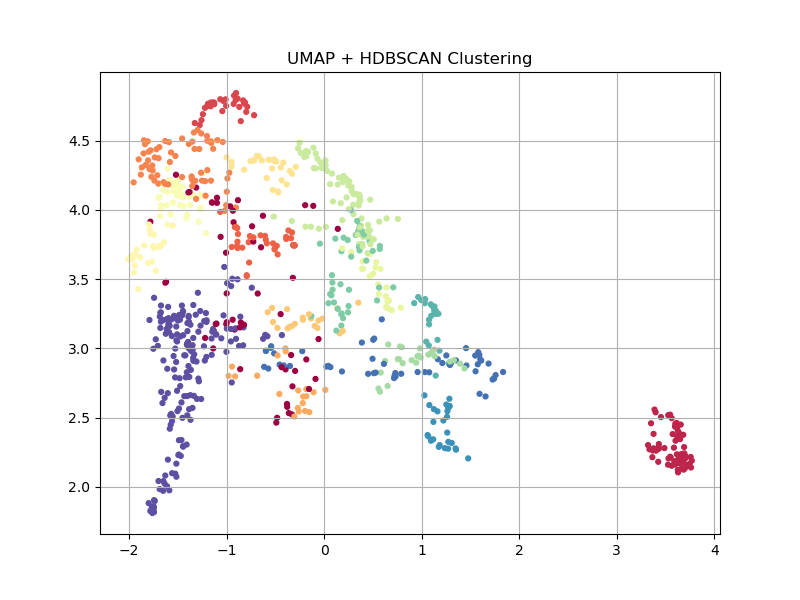

# 基于聚类的自动驾驶路测关键场景识别研究

## 导师审查骨架稿

> 文档性质：论文初稿/章节骨架稿
> 数据基础：nuScenes v1.0-trainval
> 当前方法主线：场景级特征构建—UMAP 降维—HDBSCAN 聚类—关键场景综合评分
> 结果口径：2026 年 6 月 850 场景完整批次作为阶段性结果；2026 年 7 月方法优化作为开发版进展
> 说明：本稿用于核查研究思路、方法结构与已有实验，不含正式参考文献，不作为最终定稿。

## 摘要

随着自动驾驶道路测试规模持续扩大，测试车辆能够积累大量包含车辆运动、交通参与者交互和道路环境信息的数据。然而，常规稳定场景在路测数据中占据较高比例，真正需要优先复盘的低频、异常或潜在高风险场景容易被淹没。完全依赖人工回看不仅耗时，而且难以形成稳定、可复现的筛选标准；单纯依靠预设阈值触发又容易受到规则覆盖范围限制。因此，如何在缺少大规模人工标注的条件下，对路测场景进行结构化表达、自动分组和优先级排序，是提升自动驾驶测试数据利用效率的重要问题。

本文以 nuScenes v1.0-trainval 为数据基础，将 scene 作为基本分析单元，构建面向自动驾驶测试的场景级特征表示。特征体系覆盖自车运动、交通密度、交通参与者构成、道路语义以及车辆、弱势交通参与者之间的交互事件。在此基础上，对聚类输入特征进行标准化，利用 UMAP 保留高维场景数据的局部相似结构，再采用 HDBSCAN 自动识别场景簇与噪声样本。为使聚类结果能够服务于工程筛选，本文进一步从场景稀有性、簇内异常程度、观测风险和决策需求等维度构建关键场景综合评分，对候选场景进行排序。

阶段性完整实验覆盖 850 个场景，得到 14 个有效簇和 104 个噪声样本，噪声占比为 12.24%。结果表已经保留 `scene_name` 与 `scene_token`，能够支持聚类结果向原始场景回溯。当前实验表明，场景级特征、无监督聚类与综合评分相结合的技术路线能够形成从原始数据到候选关键场景列表的完整分析链路。2026 年 7 月进一步开展了事件窗口化、聚类特征白名单、分组物理风险和决策需求建模等优化，并在 50 个场景上完成程序级验证；由于该调试样本在当前参数下全部被判为噪声，尚不能据此评价最新版聚类效果。后续将通过 850 场景全量重跑、KMeans 基线、参数敏感性分析和人工回看进一步验证方法的稳定性及工程有效性。

**关键词：** 自动驾驶测试；关键场景；场景聚类；UMAP；HDBSCAN；corner case；无监督学习

# 第一章 绪论

## 1.1 研究背景

自动驾驶系统的安全验证需要覆盖不同道路结构、交通密度、交通参与者构成和交互方式。随着测试车辆数量与测试里程增加，企业能够获得更丰富的真实道路数据，但数据规模增长也带来了新的工程矛盾：采集能力快速提升，而人工分析、问题定位和场景复用能力相对有限。大量测试资源被用于存储和处理常规数据，真正具有复盘价值的场景却可能因出现频率低、触发模式复杂而未被及时发现。

工程实践中的关键场景并不只等同于已经发生碰撞或接管的场景。某些场景虽然没有产生危险后果，却包含复杂交互、较高决策负荷或对感知与规划能力具有挑战的道路条件；另一些场景可能在统计分布上稀有，或者明显偏离同类场景的典型模式。这些场景对问题复现、算法回归、仿真用例构建和测试资源分配具有较高价值。因此，本文将关键场景理解为需要在有限测试资源下被优先识别和复核的场景，具体包括低频场景、簇内异常场景、具有明确风险证据的场景以及决策需求较高的场景。

现有筛选方式主要包括人工经验筛选和规则触发。人工筛选能够结合上下文进行判断，但效率和一致性受人员经验影响；规则方法易于工程部署，却依赖预先设定的指标和阈值，对未知模式的发现能力有限。无监督学习不要求预先提供完整场景标签，可利用数据分布发现潜在结构，为大规模路测数据的初筛提供了可行路径。但聚类标签本身并不能直接回答“哪些场景应优先复盘”，仍需要结合稀有性、异常性、风险性和工程可解释性建立后续评价机制。

## 1.2 研究问题与研究目标

本文围绕以下核心问题展开：如何在缺少大规模人工标注的条件下，从自动驾驶路测数据中构建可解释的场景级表示，识别潜在场景结构，并形成面向测试复盘的关键场景优先级排序？

围绕该问题，本文设定四项研究目标。第一，将帧级车辆状态、交通参与者和地图信息聚合为场景级特征，使不同场景能够在统一特征空间中比较。第二，利用 UMAP 与 HDBSCAN 对场景进行无监督分组，识别高频场景簇以及低密度、异常样本。第三，构建融合稀有性、簇内异常和风险/决策需求的综合评分，使聚类结果能够转化为可操作的候选列表。第四，基于 nuScenes 开展阶段性验证，并通过基线对比、参数分析和人工回看逐步评价方法的合理性。

本文的目标不是直接预测事故概率，也不试图仅凭无监督聚类给出安全结论。研究输出是场景复盘的优先级依据，其价值应通过是否能够减少无效回看、是否能够覆盖有代表性的复杂交互以及排序是否具有工程解释性来评价。

## 1.3 研究内容与技术路线

本文按照“数据解析—场景表示—无监督聚类—综合评分—场景复核”的路线展开。首先读取 nuScenes 场景、sample、ego pose、annotation 和 map 等信息，以 scene 为单位进行时序聚合。其次分别构建描述整体环境的统计特征和描述持续交互过程的事件窗口特征。再次，从全部输出字段中选择适合表达场景语义的特征进行标准化和 UMAP 降维，随后使用 HDBSCAN 得到场景簇、成员概率和离群程度。最后，依据簇规模、簇内异常、物理风险与决策需求计算关键场景综合评分，并将高分场景回连到原始数据进行人工检查。

当前研究已经完成 850 场景的完整分析批次，并在此基础上对特征定义和评分机制进行了进一步优化。由于最新版方法尚未完成 850 场景全量重跑，本文在结果表达上采用双层口径：完整批次用于说明已有实验结果，开发版用于说明方法改进方向和程序验证情况。

## 1.4 论文结构

第一章说明研究背景、问题、目标和技术路线。第二章梳理关键场景、场景表示、无监督聚类与替代安全指标的理论基础。第三章定义研究对象、输入输出及总体识别框架。第四章说明场景级特征、事件窗口、特征选择、UMAP 与 HDBSCAN 方法。第五章介绍关键场景综合评分。第六章报告阶段性完整结果和方法优化进展，并明确待补实验。第七章总结现有结论、研究边界与下一阶段计划。

# 第二章 理论基础与相关研究

## 2.1 自动驾驶场景化测试与关键场景

场景化测试以具有明确时间和空间边界的交通片段为分析对象，将连续路测数据转化为可描述、可比较和可复用的测试单元。与仅按里程统计相比，场景级分析能够更直接地连接道路结构、交通参与者行为和自动驾驶系统响应。对于大规模测试数据，场景化处理还有助于建立场景库、识别覆盖空白并选择回归测试用例。

关键场景具有多维属性。稀有性强调场景在数据分布中的低频程度；异常性强调单个样本相对同类场景的偏离；风险性强调已有交通冲突或强烈车辆响应；决策需求则强调即使危险后果已经通过停车或让行被消解，场景仍可能要求系统完成观察、判断和通行决策。本文不把上述属性简单合并为同一概念，而是将其作为关键场景排序的互补依据。

## 2.2 场景表示与特征构建

原始自动驾驶数据通常以传感器帧、车辆位姿、目标标注和地图元素等形式存储。若直接对高维原始数据进行聚类，结果容易受数据尺度、采样频率和无关波动影响。因此，需要先建立场景级表示。统计聚合可以描述场景整体特征，例如平均速度、交通参与者数量和道路语义密度；事件窗口则能够保留跟驰、合流、横穿、停车让行等交互的出现次数、持续时间与强度。

场景表示需要在信息量与可解释性之间取得平衡。过少的特征无法区分复杂交互，过多的结果型风险变量又可能使聚类直接按照危险程度分组，削弱场景语义。本文因此区分两类字段：一类用于聚类，描述环境与行为结构；另一类用于评分，描述冲突后果、异常程度和工程优先级。

## 2.3 无监督降维与密度聚类

不同特征的量纲和取值范围存在差异，聚类前需要通过标准化降低尺度影响。UMAP 是一种非线性降维方法，可将高维数据映射到较低维空间，并侧重保留局部邻域结构。本文使用 UMAP 将标准化后的场景语义特征映射到十维空间，以减少高维距离计算的复杂性。

HDBSCAN 是基于密度的层次聚类方法，不要求预先指定固定簇数，并能将低密度样本识别为噪声。该特性与自动驾驶场景可能具有分布不均和长尾样本的特点相匹配。与此同时，HDBSCAN 的噪声标签不能直接解释为危险场景，簇规模较小也不必然代表高风险。因此，聚类输出只提供场景结构和异常线索，需要与物理风险证据和人工复核结合。

## 2.4 替代安全指标与工程解释

碰撞时间（Time to Collision，TTC）、跟车距离、急减速和冲突持续时间等指标常用于描述交通交互的紧迫程度。这类指标能够在未发生碰撞时提供风险线索，但其有效性取决于目标筛选、相对运动假设和持续时间证据。例如，相邻车道车辆或转弯车辆若被错误纳入纵向 TTC，可能造成虚假高风险；单帧极小值也可能来自标注重叠或瞬时噪声。

因此，本文在开发版中使用基于自车坐标系的前向和横向筛选，并将最小值与有效帧比例、持续时间等证据结合。同时，将主动停车让行与高风险后果分开处理：停车可能降低剩余冲突，却不意味着该场景没有决策价值。这一思路构成观测风险与决策需求分离的基础。

# 第三章 自动驾驶路测关键场景识别问题与总体框架

## 3.1 研究对象与分析单元

本文以 nuScenes v1.0-trainval 中的 scene 为分析单元。每个 scene 由连续 sample 构成，并关联自车位姿、交通参与者标注、传感器数据和地图信息。选择 scene 作为基本单元，一方面能够覆盖一段连续驾驶过程，另一方面能够将帧级信息压缩为适合聚类和排序的固定长度向量。

系统输入包括场景元数据、时间戳、自车位姿、目标类别与位置、道路和控制语义等。中间输出为带有 `scene_name`、`scene_token` 和场景特征的表格。最终输出包括 UMAP 表示、HDBSCAN 聚类标签、成员概率、离群分数、风险子分数和关键场景综合得分。场景标识在全链路中保留，以支持候选结果向原始场景回溯。

## 3.2 关键场景判定逻辑

本文不采用单一阈值定义关键场景，而是从四个角度形成排序依据。第一，场景所属簇越小，其模式在当前数据集中的出现频率越低。第二，场景在所属簇中的离群程度越高，越可能包含不同于同类样本的行为。第三，场景存在较强纵向冲突、合流或横穿冲突、弱势交通参与者冲突或明显自车响应时，观测风险上升。第四，在非信号控制路口存在横向车辆或弱势交通参与者暴露时，即使车辆已经采取停车让行，仍可能具有较高决策需求。

四类信息的作用不同。稀有性和异常性来自数据分布，适合发现未知模式；观测风险来自具有物理含义的交互证据；决策需求体现测试复盘价值。综合评分将它们统一到优先级排序中，但不将得分解释为安全概率。

## 3.3 总体分析流程

总体流程包括五个阶段。第一阶段完成数据解析、时间对齐和坐标转换。第二阶段以 scene 为单位计算统计特征与事件特征。第三阶段应用显式特征白名单，处理缺失值并进行标准化和 UMAP 降维。第四阶段使用 HDBSCAN 聚类，输出簇标签、成员概率和离群分数。第五阶段计算分组风险与综合得分，生成候选场景列表并开展人工回看。

为保证结果可复现，正式实验需记录脚本版本、输入文件、运行环境、日期、参数和输出路径。当前仓库已将特征提取、聚类、评分和回看拆分为独立脚本，并支持通过环境变量指定调试输入和输出。最终全量实验仍需在最新脚本上重新运行并形成完整日志。

# 第四章 场景级特征构建与无监督聚类方法

## 4.1 场景统计特征

场景统计特征用于描述整个场景的总体状态。自车运动特征包括平均速度、速度波动、加速度、减速度和航向变化，用于反映通行状态与驾驶行为。交通环境特征包括一定范围内车辆数量、密度波动和周边车辆速度离散程度，用于描述拥堵程度与动态复杂性。参与者结构特征包括行人、大型车辆、自行车、摩托车和动态两轮车比例。地图语义特征包括路口、车道连接、人行横道、交通灯、停车标志和非信号控制路口等密度。

统计特征计算需要保持统一的空间范围和时间基准。开发版将周边车辆限制在自车 50 米范围内，自车速度和加速度依据真实 sample 时间戳计算，并对航向角正负 π 跳变进行处理。这些调整用于降低采样间隔和角度表示带来的异常波动。

## 4.2 事件窗口化交互特征

单纯使用整段均值可能掩盖短时但重要的交通交互。为此，开发版引入事件窗口，将连续满足规则的帧组合为具有起止时间的事件。当前事件类型包括同车道跟随、合流暴露与冲突、横向车辆暴露与冲突、弱势交通参与者路径交互、静止前车、避让换道以及路口停车与再起步等。

每类事件可计算出现比例、事件次数、最长持续时间和最小距离等指标。纵向 TTC 只对自车前向且位于较窄横向中心带内的目标计算，以减少相邻车道和转弯车辆误入。车辆车身尺寸被用于估算净间距，并过滤明显重叠的标注。对于弱势交通参与者，进一步区分横穿暴露、同车道暴露、同向行走和障碍避让窗口中的复合冲突，使特征能够表达不同测试挑战。

事件窗口化的目的不是直接生成标签，而是把“目标出现—路径交互—风险后果—车辆响应”拆开。这样既能保留复杂交互信息，也能避免把所有目标暴露都等同为危险。

## 4.3 聚类特征白名单

开发版通过显式白名单选择聚类特征。白名单包含交通速度与密度、自车运动状态、跟驰持续时间、合流和横穿暴露、弱势交通参与者暴露、避让行为、参与者构成以及道路控制语义等字段。TTC、急刹、默认距离、帧数量等结果型或容易受哨兵值影响的字段不直接作为聚类输入。

这一设计使聚类更侧重“场景是什么”，而不是“场景得分多高”。风险变量在后续评分阶段独立使用，从而减少聚类与评分之间的循环定义。白名单采用固定顺序，并只选择输入表中实际存在的字段，便于不同开发批次进行兼容性验证。

## 4.4 数据预处理与 UMAP 降维

聚类前首先处理无穷值和缺失值，再使用 StandardScaler 将各特征转换到可比较尺度。当前 UMAP 参数为邻居数 15、最小距离 0、输出维度 10、距离度量 cosine，随机种子设置为 42。十维表示用于 HDBSCAN 聚类，二维可视化则取降维结果的前两个维度绘制散点图。

当前参数来自前期试验与工程判断，但现有仓库尚未保存与最新版特征严格对应的完整网格搜索结果。因此，本稿只将其表述为当前配置，不能据此声称已经获得全局最优参数。参数敏感性和随机稳定性需要在最新版 850 场景结果上重新验证。

## 4.5 HDBSCAN 聚类

当前 HDBSCAN 设置为 `min_cluster_size=20`、`min_samples=1`，并开启 prediction data。聚类输出包括 `cluster`、`cluster_probability` 和 `cluster_outlier_score`。其中，`cluster=-1` 表示在当前密度结构和参数下未被分配到稳定簇的样本；成员概率反映样本对所属簇的归属强度；离群分数用于描述样本相对簇结构的异常程度。

噪声比例和簇数量会受到特征定义、降维参数与 HDBSCAN 参数共同影响。特别是在 50 场景调试集上，`min_cluster_size=20` 会显著限制可形成的稳定簇数量。因此，小样本调试结果适合验证程序和字段逻辑，不适合直接评价正式聚类效果。

# 第五章 关键场景综合评分方法

## 5.1 评分设计原则

关键场景评分需要同时利用数据分布信息和物理风险信息。若只按稀有性排序，可能把低频但无工程意义的场景置于前列；若只按风险阈值排序，又会退化为规则触发并忽略未知异常。本文采用“稀有性—簇内异常—风险/决策需求”的组合结构，并保留各子分数，以支持测试人员解释高分原因。

## 5.2 稀有性与簇内异常

对于非噪声簇，稀有性根据簇规模占总样本数的比例计算，簇越小，稀有性越高。对于噪声样本，稀有性设置为接近 1 的值，表示其未进入稳定簇结构。该处理体现噪声样本的低密度属性，但不意味着噪声样本天然危险。

簇内异常采用 HDBSCAN 输出的 `cluster_outlier_score`，并限制在 0 至 1 范围内。相较于旧版基于降维空间中心距离计算异常性，直接使用 HDBSCAN 离群分数能够与密度聚类结构保持一致。该指标仍会受参数配置影响，因此需要结合风险证据和人工回看使用。

## 5.3 观测风险

观测风险由四组子分数组成。纵向风险综合 TTC 严重程度、TTC 有效证据、危险状态持续性和近距跟驰比例；车辆交互风险取合流冲突与横向车辆冲突的较高值，并考虑停车让行对剩余风险的削弱；弱势交通参与者风险根据路径相关性和冲突持续时间计算；自车响应风险由急刹比例和最大减速度构成。

当前开发版中，观测风险按纵向风险 0.35、车辆交互风险 0.30、弱势交通参与者风险 0.25、自车响应风险 0.10 加权。各特征先依据固定物理尺度截断到 0 至 1，避免使用同一批次数据的最小值和最大值定义风险高低。该评分反映在数据中已经观察到的冲突证据，不用于推断事故必然发生。

## 5.4 决策需求

决策需求主要描述非信号控制环境下的观察与通行判断负荷。该分数结合非信号路口密度、横向车辆或弱势交通参与者暴露、自车接近或由运动转为停车的状态，并在交通灯控制密度较高时进行抑制。停车让行可以降低当前剩余冲突，但场景仍可能对感知、预测和规划形成测试价值，因此决策需求与观测风险分别保留。

开发版将总风险定义为观测风险加 0.20 倍决策需求，并截断到 0 至 1。该设计仍属于待通过全量实验和人工案例验证的评分假设，后续需要分析其对 Top 场景排序的影响。

## 5.5 综合评分与使用边界

最新版关键场景综合得分由稀有性、簇内异常和风险加权得到：稀有性权重为 0.20，簇内异常权重为 0.25，风险权重为 0.55。随后使用当前批次的得分范围将结果归一化到 0 至 1，生成 `corner_score_norm` 便于排序。

综合得分是工程复盘优先级，不是安全等级，也不应跨不同数据批次直接比较绝对值。正式应用时应同时展示高分原因、关键子分数和对应场景标识，并通过原始图像、轨迹或事件摘要进行人工确认。

# 第六章 阶段性实验结果与分析

## 6.1 数据集与实验批次

阶段性完整实验使用 nuScenes v1.0-trainval 中可处理的 850 个 scene。2026 年 6 月生成的主特征表包含场景名称、场景 token、日志地点以及 25 个数值型场景字段；聚类结果进一步包含 10 个 UMAP 维度和聚类标签；评分表在此基础上增加稀有性、异常性、风险和综合得分等字段。该批次能够支持完整流程展示和场景回溯。

需要说明的是，6 月完整结果早于 7 月事件窗口化和分组风险优化，不能被表述为最新版方法的最终结果。4 月形成的簇语义工作簿和 Top20 分析表对应更早的结果批次，其簇数量与 6 月结果不同，本稿不将其中的语义标签和 Top20 结论拼接到当前完整结果中。

## 6.2 完整批次聚类结果

6 月完整批次共得到 15 种标签，其中包括 14 个有效簇和噪声类。104 个场景被标记为噪声，占 850 个场景的 12.24%；其余 746 个场景分布在 14 个有效簇中。最大簇包含 200 个场景，最小有效簇包含 20 个场景，说明当前特征空间中既存在较集中模式，也存在低密度样本。

图 6-1 为现有 UMAP 可视化。散点图可用于观察不同聚类标签在前两个降维坐标上的分布，但不能仅凭二维投影判断全部十维空间中的分离质量。现阶段能够得到的审慎结论是：完整链路能够在无人工场景标签条件下形成多个场景组，并识别一定比例的噪声样本。各簇的稳定语义、组间差异和工程含义仍需依据当前批次重新计算簇画像并结合场景回看确认。

## 6.3 完整批次评分结果

6 月评分表已为 850 个场景生成 `rarity`、`atypical`、`risk`、`corner_score` 和 `corner_score_norm`，归一化得分范围为 0 至 1。该结果证明聚类输出可以进一步转化为候选场景排序，并通过 `scene_name` 和 `scene_token` 回连原始数据。

由于 6 月批次采用的是旧版评分定义，而 4 月 Top20 人工分析又对应另一批聚类标签，本稿不列出未经重新核验的 Top 场景类型和案例结论。待最新版全量重跑后，应从高分、低分和不同得分来源中分层抽样，检查排序是否真正覆盖低 TTC、持续冲突、弱势交通参与者交互、复杂路口决策以及无意义离群样本。

## 6.4 7 月方法优化与调试验证

7 月开发版主要完成四类优化。第一，特征提取从场景整体统计扩展到事件窗口，增加跟驰、合流、横穿、弱势交通参与者、静止前车、避让和停车再起步等连续事件。第二，聚类使用显式场景语义白名单，不再让 TTC、急刹和默认距离直接定义场景簇。第三，HDBSCAN 输出成员概率和离群分数，并将离群分数作为簇内异常依据。第四，风险评分改为固定物理尺度下的分组风险，并增加决策需求。

开发版已在 50 个场景上生成特征、聚类和评分调试表，验证了字段生成、模块衔接和输出结构。该批次在当前 `min_cluster_size=20` 配置下 50 个样本全部被标记为噪声，因此不能用于评价簇数量、噪声比例、综合得分排名或相对旧版的性能提升。其意义仅在于说明最新版代码链路能够运行，并为全量实验前的规则复核提供数据。

## 6.5 待补实验与评价方案

**【待更新数据：最新版 850 场景全量结果】** 使用 7 月开发版脚本重新生成正式特征表、聚类表、评分表和聚类图，核验样本数、特征列、簇数、噪声比例和得分分布。

**【待补实验：参数敏感性与稳定性】** 对 UMAP 邻居数、输出维度、距离度量以及 HDBSCAN 的最小簇规模和最小样本数进行组合试验，比较簇数量、噪声比例、成员概率、重复运行一致性和簇语义稳定性。

**【待补实验：KMeans 基线】** 在相同场景和可比特征集上运行 KMeans，比较预设簇数要求、簇内紧致度、异常样本处理能力、场景语义可解释性和工程使用差异。现有 KMeans 文件属于历史实验，尚不能作为与最新版 HDBSCAN 的公平比较。

**【待补实验：簇语义与案例回看】** 对最新版各簇计算特征画像，选取簇内代表场景和边界样本；按照综合得分来源分层选择高分场景，结合图像/GIF、轨迹和事件摘要进行人工复核，并记录有效关键场景、误报原因和数据缺失问题。

# 第七章 结论与下一阶段工作

## 7.1 阶段性结论

本文针对大规模自动驾驶路测数据中关键场景筛选效率不足的问题，构建了以 scene 为分析单元的无监督处理流程。该流程能够将自车状态、交通环境、参与者结构和地图语义等信息转换为场景级特征，通过 UMAP 与 HDBSCAN 识别场景结构，再利用稀有性、异常性和风险信息生成复盘优先级。

基于 850 个 nuScenes 场景的阶段性完整实验，当前流程得到 14 个有效簇和 104 个噪声样本，并完成场景综合评分和标识回溯。这些结果支持“场景级表示—无监督聚类—关键场景排序”技术路线的可行性，但尚不足以证明最新版方法优于基线，也不能直接证明排序能够稳定提升实际测试效率。

事件窗口化、聚类特征白名单、分组物理风险和决策需求的开发版优化已经完成小样本程序验证。其主要价值在于增强场景语义与风险证据的分离，提高高分原因的可解释性。由于尚未完成最新版全量实验，相关效果需要在后续结果中确认。

## 7.2 研究边界

本研究使用公开数据集而非企业真实量产测试闭环，数据规模、传感器完整性和场景分布均存在边界。nuScenes 缺少交通灯相位等部分动态地图信息，本地还可能存在个别相机文件缺失。无监督聚类缺少天然真值标签，聚类质量不能只依赖单一内部指标。综合评分中的阈值和权重具有工程假设，需要通过案例回看、敏感性分析和专家反馈校准。

此外，当前方法以 scene 级聚合为主，能够降低数据规模并支持批量分析，但可能弱化场景内部更细粒度的时序变化。事件窗口能够部分缓解这一问题，仍不能替代完整轨迹建模或端到端风险预测。

## 7.3 下一阶段工作

下一阶段首先锁定最新版脚本和环境，完成 850 场景全量重跑并记录可复现命令。随后开展 UMAP/HDBSCAN 参数敏感性和稳定性分析，在相同输入条件下补充 KMeans 基线。基于正式结果重新生成簇画像与语义标签，并对高分、低分及不同风险来源的场景进行分层人工回看。最后，根据实验反馈调整评分阈值和权重，补充正式参考文献、图表与方法公式，形成论文完整稿。

---

## 导师审查重点提示

1. 研究主线是否清晰：场景表示、无监督聚类与关键场景排序之间是否形成完整闭环。
2. 方法更新是否合理：将场景语义特征与风险结果特征分开，并将观测风险与决策需求分开处理。
3. 阶段结果是否足以支撑继续研究：850 场景完整批次已验证流程，最新版方法仍需全量重跑。
4. 后续实验是否充分：参数稳定性、KMeans 基线、簇语义解释和人工案例复核是否满足论文验证要求。
